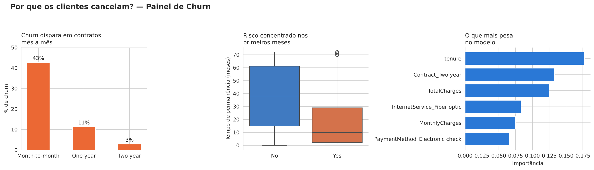

# Previsão de Churn de Clientes — Projeto de Parceria EBAC × Semantix

Projeto final do curso "Profissão: Cientista de Dados" (EBAC), em parceria com a Semantix: um projeto de dados completo, do problema de negócio à comunicação dos resultados, construído de forma independente ao longo do curso.

**Autora:** Marina Gomes

## Problema de negócio

Uma empresa de telecomunicações (internet, telefonia e serviços de streaming de TV/filmes) perde uma parcela relevante da sua base de clientes todos os meses — o fenômeno de **churn**. Para um time de Customer Success/Retenção, cada cancelamento representa a perda da receita recorrente e do custo de aquisição já investido nesse cliente.

Se a empresa só identifica o risco de cancelamento no momento em que o cliente pede para sair, a oportunidade de retê-lo já passou. Um modelo preditivo permite **identificar com antecedência quais clientes têm maior probabilidade de cancelar**, a partir de características de contrato, forma de pagamento e serviços contratados — permitindo ação **proativa** do time de retenção (desconto, migração de plano, contato consultivo) em vez de reativa.

- **Tarefa de Machine Learning:** classificação binária
- **Variável-alvo:** `Churn` (`Yes` = cancelou / `No` = permanece ativo)

> Conexão com minha experiência: atuo como Customer Success Manager em publicidade digital (CTV/Samsung Ads), lidando diariamente com relacionamento e retenção de contas — a lógica de negócio deste projeto (identificar sinais de risco antes da perda do cliente) é a mesma que aplico no meu trabalho, resolvida aqui com um modelo estatístico em vez de acompanhamento manual.

## Estrutura do repositório

```
├── notebook/
│   └── Projeto_Parceria_Semantix_Churn.ipynb   # notebook completo, executado de ponta a ponta
├── data/
│   └── Telco-Customer-Churn.csv                # base pública utilizada
├── images/
│   └── painel_churn_storytelling.png           # visualização de Data Storytelling
├── requirements.txt
└── README.md
```

## 1. Coleta de dados

**Fonte:** [Telco Customer Churn Dataset](https://raw.githubusercontent.com/IBM/telco-customer-churn-on-icp4d/master/data/Telco-Customer-Churn.csv) — base pública disponibilizada pela IBM, amplamente usada pela comunidade de ciência de dados (incluindo no Kaggle) para benchmarking de modelos de churn, com fins educacionais.

**Natureza dos dados:** base **sintética/anonimizada**, sem dados reais de clientes de nenhuma operadora — não há nomes, documentos ou qualquer dado pessoal identificável além de um `customerID` artificial. Fonte **pública e não confidencial**.

**Volume:** 7.043 clientes, 21 colunas — dados demográficos (gênero, idade sênior, dependentes), de contrato (tipo, forma de pagamento, cobrança sem papel), de serviços contratados (internet, telefone, segurança online, suporte técnico, streaming de TV e filmes) e financeiros (cobrança mensal, cobrança total, tempo de permanência/`tenure`).

**Armadilha estrutural identificada:** a coluna `TotalCharges` veio tipada como texto, escondendo 11 valores de string vazia — investigando a causa, descobrimos que são clientes com `tenure = 0` (recém-cadastrados, que ainda não fecharam o primeiro ciclo de cobrança). Por isso, foram preenchidos com `0` (refletindo o fato real de negócio), e não com uma imputação estatística genérica que distorceria o significado da variável.

## 2. Modelagem

**Preparação dos dados (sem vazamento):**
1. Remoção de `customerID` (sem poder preditivo).
2. Correção/conversão de `TotalCharges` para numérico, com tratamento da armadilha acima.
3. Codificação One-Hot das variáveis categóricas.
4. Separação treino/teste (80/20, `stratify=Churn`) feita **antes** de qualquer transformação sensível.
5. Escalonamento (`StandardScaler`) ajustado **apenas no treino**, aplicado em treino e teste.

**Modelos comparados:**
- **Regressão Logística** (`class_weight='balanced'`) — baseline interpretável. ROC-AUC em validação cruzada (5 folds): **0,8459** (±0,0124).
- **Random Forest** com `RandomizedSearchCV` (25 combinações testadas) + validação cruzada estratificada (5 folds), otimizando por ROC-AUC. Melhores hiperparâmetros: `n_estimators=350, max_depth=8, min_samples_split=10, min_samples_leaf=1, class_weight='balanced'`. Melhor ROC-AUC em validação cruzada: **0,8473**.

**Resultado no conjunto de teste (nunca visto durante o treino/tuning):**

| Métrica (classe Cancela) | Regressão Logística | Random Forest (tunado) |
|---|---|---|
| Precisão | 0,50 | 0,52 |
| Recall | 0,78 | 0,80 |
| F1-score | 0,61 | 0,63 |
| Acurácia geral | 0,738 | 0,752 |
| ROC-AUC | 0,8417 | **0,8441** |

O Random Forest superou a Regressão Logística em todas as métricas, confirmando que relações não-lineares entre as variáveis (ex.: a combinação de contrato mensal + baixo tenure + ausência de serviços adicionais) importam para prever churn.

**Variáveis mais importantes** (Random Forest): `tenure`, `Contract_Two year`, `TotalCharges`, `InternetService_Fiber optic`, `MonthlyCharges`, `PaymentMethod_Electronic check` — todas consistentes com os achados da análise exploratória.

## 3. Conclusões

**Modelo recomendado:** Random Forest tunado, por ter o melhor ROC-AUC e o melhor recall da classe Cancela — captura 80% dos cancelamentos reais no conjunto de teste, o que é o indicador mais relevante para uma estratégia de retenção proativa (deixar passar um cliente em risco tem, em geral, custo maior do que uma ação de retenção desnecessária).

**Segmento prioritário para retenção:** o cruzamento da EDA com a importância de variáveis do modelo aponta um perfil de risco claro — **clientes com contrato mês a mês, tenure baixo (menos de ~12 meses) e sem serviços adicionais contratados** (segurança online, suporte técnico). Esse segmento concentra a maior parte do risco e é o ponto de partida natural para uma campanha de retenção direcionada.

**Recomendação de negócio:** priorizar ação de retenção proativa logo nos primeiros meses do relacionamento — oferta de migração para contrato mais longo, ou inclusão gratuita de serviços de proteção/suporte por período limitado — já que o custo dessa ação tende a ser bem menor do que o custo de adquirir um novo cliente para substituir o que foi perdido.

**Próximos passos sugeridos:**
1. Validar o modelo com dados de produção mais recentes e reavaliar periodicamente (comportamento de churn muda com o tempo e com o mercado).
2. Testar diferentes limiares de decisão (*threshold tuning*), equilibrando custo de ação desnecessária vs. custo de não agir sobre um cliente que cancelaria.
3. Enriquecer o modelo com dados de atendimento (chamados, NPS, tempo de resposta) — sinais que costumam antecipar o churn antes mesmo de aparecerem no histórico de contrato.

## Visualização (Data Storytelling)



## Como reproduzir

```bash
pip install -r requirements.txt
jupyter notebook notebook/Projeto_Parceria_Semantix_Churn.ipynb
```

## Autorização LGPD

Projeto elaborado para fins de portfólio e avaliação acadêmica (EBAC × Semantix), com base de dados pública e não confidencial. Não há dados pessoais reais envolvidos.
